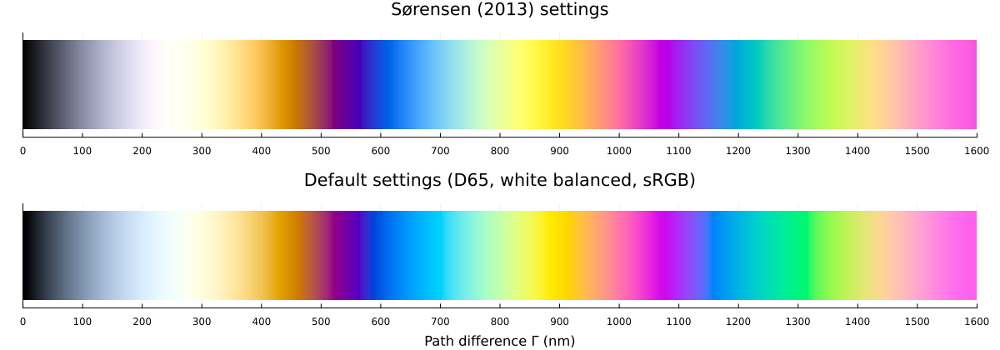

# Examples

## Michel-Lévy colours as a table, 0 to 1600 nm

[`michel_levy_0-1600nm.csv`](michel_levy_0-1600nm.csv) lists the interference colour for every path difference from 0 to 1600 nm, in 1 nm steps. It is made by [`michel_levy_table.jl`](michel_levy_table.jl), which also draws both sets of colours in [`michel_levy_0-1600nm.png`](michel_levy_0-1600nm.png) as a visual check:



The table gives two sets of RGB values, because there is no single "correct" RGB value for an interference colour: the numbers depend on the light source, the colour space and other choices (see the main [README](../README.md)).

| Column | Description |
|---|---|
| `path_difference_nm` | Path difference (retardation) Γ, in nm |
| `sorensen2013_R`, `_G`, `_B` | The colours of the published chart of Sørensen (2013), 0 to 255. Calculated with `sorensen2013()` settings |
| `srgb_R`, `_G`, `_B` | Physically based colours, 0 to 255: daylight (D65), white balanced, in the sRGB colour space with its standard gamma. The package's default settings |
| `srgb_error_dE2000` | How far the sRGB colour is from the true colour, as CIEDE2000 colour difference. Non-zero where the true colour is too saturated for sRGB and has been clipped (see below) |
| `X`, `Y`, `Z` | The true colour as CIE 1931 XYZ, with the default settings and before any clipping. Y = 1 is the brightness of the light source itself |
| `L`, `a`, `b` | The same colour in CIELAB (D65 white point) |

### Which values to use

- **To match the published chart** of Sørensen (2013), e.g. to reproduce it or compare with it: use the `sorensen2013_` columns. These are the paper's RGB values: Adobe RGB with a gamma of 0.5 for contrast, as described in the paper. Most software displays them as if they were sRGB, which is how the published chart appears on screen.
- **To compare with photographs** taken through a microscope: use the `srgb_` columns, which are in the colour space that cameras and image files normally use. They assume daylight and a camera white balanced for the light source. For a halogen lamp, regenerate the table with e.g. `illuminant=Blackbody(3200)` (see below).
- **To measure how similar two colours are**, e.g. to find the path difference that best matches a colour in a photograph: convert the photograph's colours to CIELAB and find the row with the smallest colour difference to the `L`, `a`, `b` columns. Distances in RGB do not correspond well to how different colours look.

### Clipped colours

Many interference colours, particularly in the second and third orders, are more saturated than sRGB can show. Their sRGB values are clipped to the nearest values sRGB can display, which slightly changes their hue. The `srgb_error_dE2000` column shows how large the change is: a CIEDE2000 difference of about 1 is just visible side by side. Over 0 to 1600 nm the mean error is 1.7; a quarter of rows have an error above 3, and the largest is 9.7, at Γ = 1211 nm. The `X, Y, Z` and `L, a, b` columns are not clipped.

### Regenerating the table

From the root of this repository:

```
julia --project=. -e 'using Pkg; Pkg.instantiate()'
julia --project=. examples/michel_levy_table.jl
```

To change the settings, e.g. the light source or range of path differences, edit `michel_levy_table.jl`. For example, `birefringence_array(Γ, illuminant=Blackbody(3200))` and `birefringence_XYZ(Γ, illuminant=Blackbody(3200))` give the colours under a 3200 K halogen lamp.

If you use these values in published work, please cite the package and Sørensen (2013).
